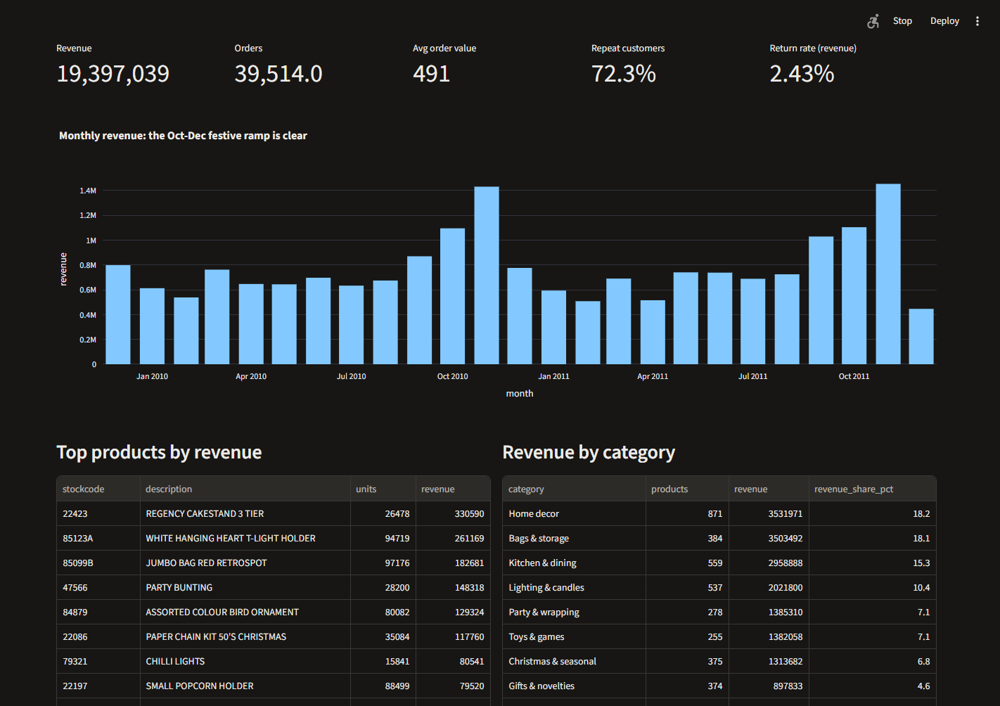
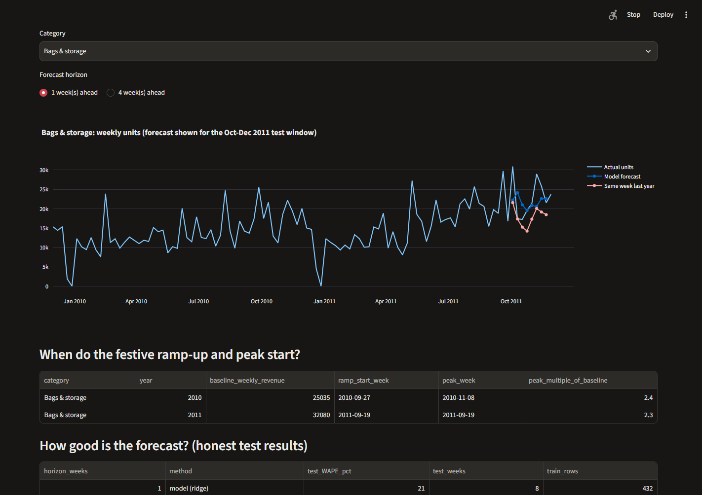
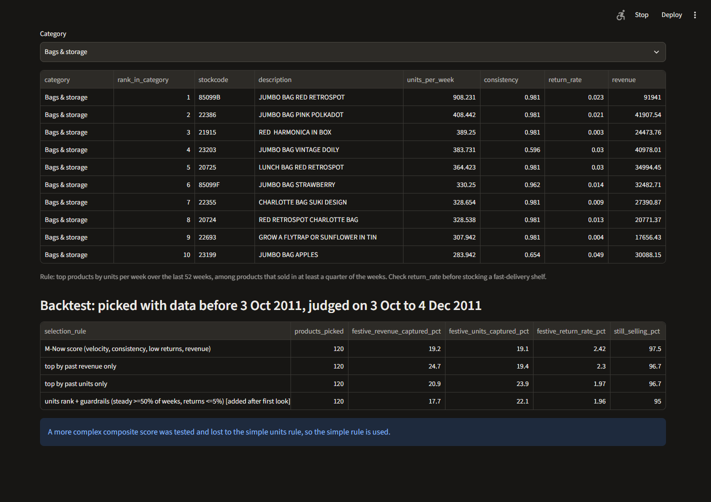
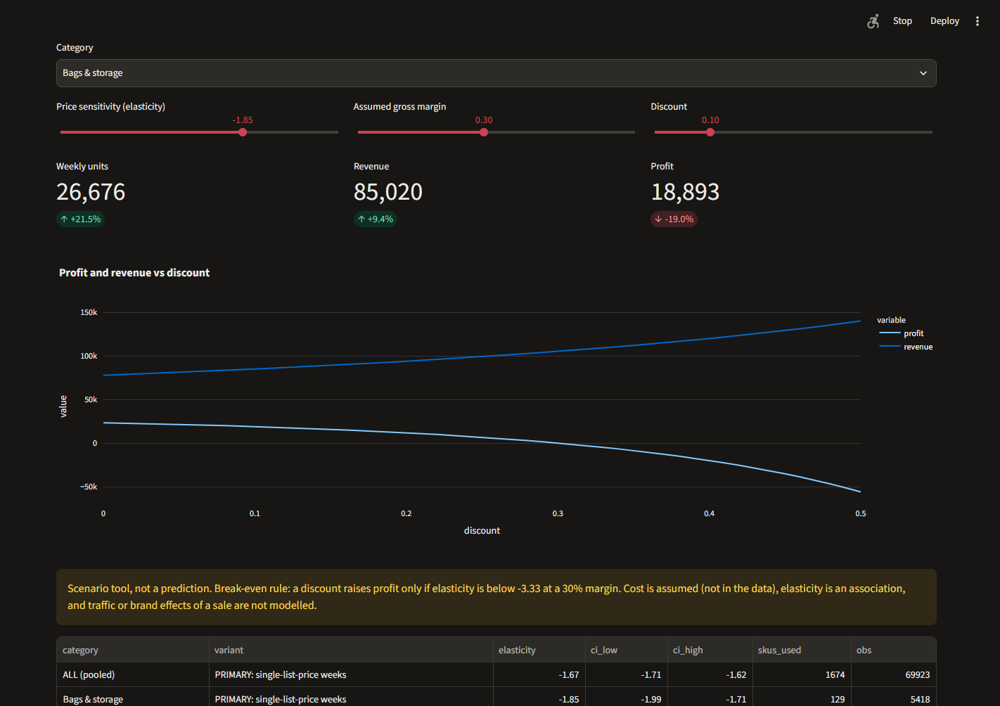
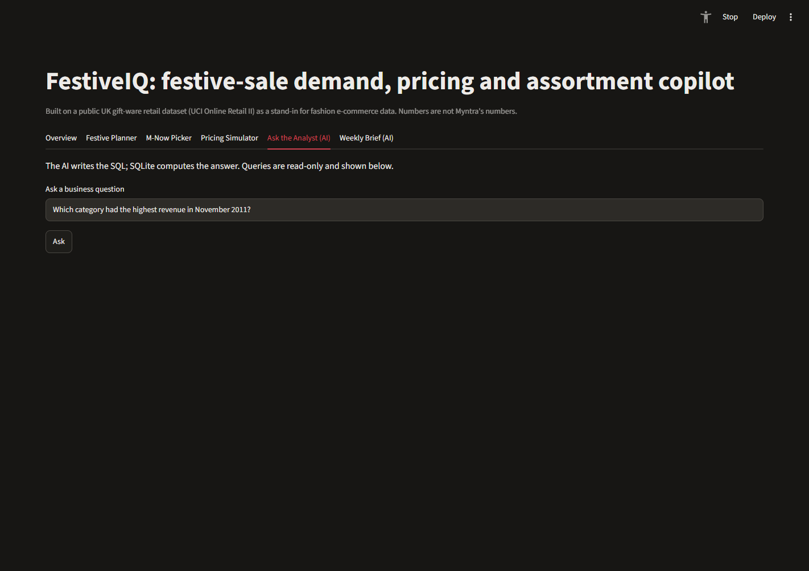
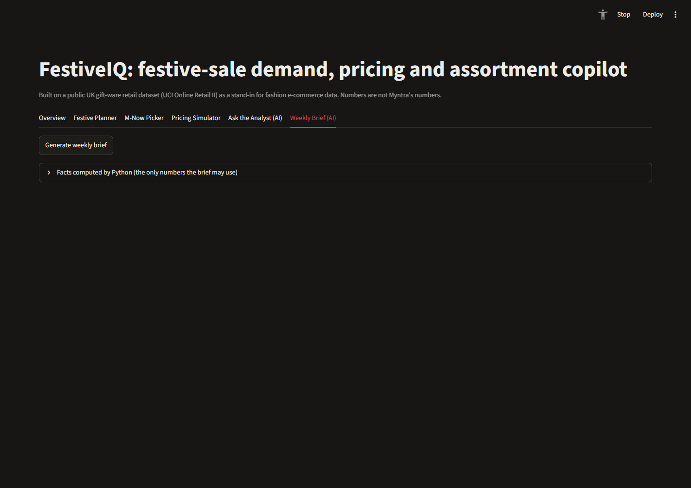

# FestiveIQ: Master Project Guide & Interview Portfolio
**An AI Copilot for Festive-Sale Demand Planning, Pricing, and Quick-Commerce Assortment**  
*Prepared for Hima · Project Portfolio for Myntra Business Functions Internship Application · November 2026*

---

## 1. Executive Summary & The Problem Statement

During high-velocity festive shopping events (such as the Myntra Big Fashion Festival, Diwali, or Christmas sales), Category Managers and Demand Planners face three billion-dollar commercial questions:

1. **Inventory Sizing & Ramp-Up Timing**: When does demand truly surge, and how many units will sell per category? (Over-ordering ties up working capital in dead stock; under-ordering causes stock-outs that lose customers to competitors).
2. **Pricing & Margin Preservation**: How much discount should be offered? (Uninformed price cuts trigger high sales volume while destroying gross margin).
3. **Quick-Commerce Assortment Allocation (M-Now)**: Which specific products deserve ultra-fast delivery shelf space (e.g., 30-minute delivery dark stores)? (Dark stores have severely constrained physical shelf space; only high-velocity, high-consistency, and low-return SKUs can be placed there).

### How FestiveIQ Solves This
FestiveIQ is an end-to-end analytical copilot built with **Python, SQLite, Scikit-Learn, Streamlit, and Gemini AI**. It transforms two years of granular retail transaction records (~1 million rows) into actionable commercial decisions through econometric pricing models, time-series forecasting, backtested assortment rules, and a hallucination-free AI interface.

---

## 2. Target Roles & Business Value

FestiveIQ bridges the gap between deep data engineering and commercial merchandising:

| Business Function | How FestiveIQ Is Applied | Key Commercial Impact |
|---|---|---|
| **Category Management** | Category-level revenue shares, return rate monitoring, and M-Now assortment allocation. | Minimizes returns, protects dark-store shelf capacity, and maximizes category GMV. |
| **Demand Planning** | 1-week and 4-week ahead category demand forecasting with seasonal peak timing. | Prevents festive stock-outs while avoiding post-sale liquidation losses. |
| **Pricing & Revenue Management** | Econometric fixed-effects price elasticity estimation and discount scenario simulations. | Enforces margin preservation rules, ensuring discounts only happen when mathematically profitable. |
| **Data Analytics / BI** | Automated Natural Language-to-SQL query generation and AI-written executive briefs. | Eliminates ad-hoc spreadsheet reporting; executives query data in plain English. |

> **Transparency Note for Interviews:**  
> Real marketplace data from Myntra is proprietary. FestiveIQ uses the public **UCI Online Retail II dataset (1,067,371 rows from 2009–2011)** as an authentic proxy. In interviews, stating clearly that this gift-ware dataset serves as a stand-in for fashion retail demonstrates professional integrity and intellectual maturity.

---

## 3. Dataset Audit & Stage 1 Data Cleaning Proofs

Raw retail data is messy and distorted by fees, accounting adjustments, cancellations, and typographical errors. Every row removed was logged with exact counts in `outputs/cleaning_log.csv`:

```
                                                        step  rows_before  rows_removed  rows_after
                                                    raw rows      1067371             0     1067371
                                   drop exact duplicate rows      1067371         34335     1033036
drop non-product stock codes (POST, DOT, M, BANK CHARGES...)      1033036          5980     1027056
                                   drop rows with price <= 0      1027056          5928     1021128
      drop negative-quantity rows that are not cancellations      1021128             0     1021128
               drop mistaken mega-order + cancellation pairs      1021128             4     1021124
                                     final: sales lines kept      1021124         17912     1003212
                   final: return lines kept (separate table)      1021124       1003212       17912
```

### Key Cleaning Decisions Defended:
1. **Duplicates (34,335 rows removed)**: Replicated logging events.
2. **Non-Product Codes (5,980 rows removed)**: Postage (`POST`), shipping fees (`DOT`), manual ledger adjustments (`M`), and bank fees (`BANK CHARGES`) were removed because they reflect administrative overhead, not consumer merchandise demand.
3. **Zero / Negative Prices (5,928 rows removed)**: Samples, damaged write-offs, or bad-debt adjustments.
4. **Mistaken Mega-Orders (4 rows removed)**: Single invoices ordering 80,995 and 74,215 units cancelled within 12 minutes by the same customer. Keeping these would falsely skew demand forecasting.
5. **Separating Cancellations (17,912 rows)**: Rather than discarding cancellations, they are preserved in a dedicated `returns` table to compute return rates by SKU and category.

---

## 4. Stage-by-Stage Technical Architecture

```
[Raw CSV: 1M+ Rows] 
        │
        ▼ (Stage 1: Clean & Deduplicate)
[SQLite Database: retail.db] ◄─── (4,706 SKUs, 1,003,212 Clean Sales Lines)
        │
        ├──► Stage 2: SQL Aggregation (KPIs, MoM Growth with LAG window functions)
        ├──► Stage 3: Product Categorization (12 Commercial Categories)
        ├──► Stage 4: Demand Forecasting (Ridge Regression vs 3 Baselines; WAPE benchmark)
        ├──► Stage 5: Quick-Commerce M-Now Assortment (Velocity + Consistency + Return Filters)
        ├──► Stage 6: Econometric Pricing (Fixed-Effects Elasticity e = -1.67, Break-even Math)
        ├──► Stage 7: Zero-Hallucination AI Layer (Read-Only SQL Generator + Verified Briefing)
        │
        ▼
[Stage 8: Interactive Streamlit Dashboard (6 Tabs)]
```

---

## 5. Visual Dashboard Walkthrough (All 6 Tabs)

### Tab 1: Executive Overview


* **Business Purpose**: Provides leadership with a bird's-eye view of macro retail performance.
* **Metrics Highlighted**:
  * **Total Revenue**: £19,397,039
  * **Total Orders**: 39,514
  * **Average Order Value (AOV)**: £491
  * **Customer Repeat Rate**: 72.3% (identified customers with 2+ purchases)
  * **Return Rate (by Revenue)**: 2.43%
* **Charts & Tables**:
  * Monthly revenue bar chart highlighting the dramatic annual Q4 festive surge (October, November, December).
  * Top revenue-generating products table (led by `REGENCY CAKESTAND 3 TIER` at £330k).
  * Category revenue distribution across all 12 commercial categories.

---

### Tab 2: Festive Demand Planner


* **Business Purpose**: Informs procurement teams when festive ramp-up begins and how many units to purchase per category.
* **Key Visuals**:
  * Interactive Plotly time-series comparing **Actual Units** against the **Machine Learning Model** and **Same Week Last Year**.
  * Ramp-up timing table: In `Bags & storage`, the festive ramp begins in week 38 (late September), reaching peak in week 45 (mid-November) at **2.4x baseline volume**.
* **Forecast Benchmark Results (Oct 3 to Dec 4, 2011 Test Window)**:

| Forecast Horizon | ML Model (Ridge) | Same Week Last Year | Last-Year $\times$ Growth | 4-Week Moving Avg | 50/50 Model + LY Blend |
|---|---|---|---|---|---|
| **1-Week Ahead** | 23.7% WAPE | 20.4% WAPE | 17.8% WAPE | **17.8% WAPE** | 19.4% WAPE |
| **4-Weeks Ahead** | 21.4% WAPE | 20.4% WAPE | 22.2% WAPE | 23.9% WAPE | **18.9% WAPE** |

> **Interview Insight**: At short horizons (1 week), recent moving averages beat ML because operational momentum dominates. At longer horizons (4 weeks), annual seasonality dominates, and a blend of ML with last year's festive pattern delivers the lowest error (18.9%).

---

### Tab 3: Quick-Commerce Assortment Picker (M-Now)


* **Business Purpose**: Identifies the top 10 SKUs per category for high-priority placement in 30-minute delivery dark stores.
* **Selection Criteria**:
  * Weekly velocity (units sold per active week).
  * Sales consistency (must sell in at least 25% of weeks).
  * Low return rate (protects forward-deployed inventory).
* **Backtest Validation (Picked before Oct 3, 2011; Tested Oct 3 to Dec 4, 2011)**:

| Selection Strategy | Festive Units Captured | Festive Return Rate | Still Selling in Peak % |
|---|---|---|---|
| **Top by Past Units (Winner)** | **23.9%** | **1.97%** | **96.7%** |
| Composite Score (Velocity + Consistency) | 19.1% | 2.42% | 97.5% |
| Top by Past Revenue | 19.4% | 2.30% | 96.7% |

> **Interview Insight**: A simpler rule (top historical units) beat a complex multi-factor score by capturing **23.9% of all festive volume** with a significantly lower return rate (1.97% vs 2.42%). FestiveIQ adheres to the engineering principle: *deploy the simplest model that wins the backtest*.

---

### Tab 4: Pricing Sensitivity & Profit Simulator


* **Business Purpose**: Empowers category managers to test discount scenarios before launching promotions.
* **Econometric Foundation**:
  * Fixed-effects log-log regression across **69,923 single-list-price SKU weeks** to estimate price elasticity ($e$).
  * Estimated pooled elasticity: **$e = -1.67$** (95% CI: $[-1.71, -1.62]$).
* **The Break-Even Mathematics**:
  $$\text{Profit} = Q \cdot (P \cdot (1 - d) - C)$$
  With an assumed gross margin $m = 30\%$, offering a discount increases total profit **only if**:
  $$|e| > \frac{1}{m} = \frac{1}{0.30} \approx 3.33$$
* **Simulated Outcome**:
  * Because $|-1.67| < 3.33$, a 10% discount increases units by $+21.5\%$ and revenue by $+9.4\%$, but **erodes net profit by $-19.0\%$**!
  * The dashboard visually displays the downward profit curve to prevent value-destructive discounting.

---

### Tab 5: Ask the Analyst (Live AI-to-SQL)


* **Business Purpose**: Enables non-technical decision-makers to query the database using plain natural English.
* **Architecture & Guardrails**:
  1. Gemini translates the natural question into standard SQLite syntax.
  2. Strict validation regex ensures only single `SELECT` or `WITH` statements execute.
  3. All DDL/DML keywords (`DROP`, `DELETE`, `UPDATE`, `INSERT`, `ALTER`, `ATTACH`) raise immediate exceptions.
  4. Database is mounted in **read-only mode** (`mode=ro`).
  5. Maximum output is capped at 200 rows.
* **Empirical Benchmark**:
  * Evaluated across **15 complex business questions** with hand-written golden SQL.
  * **Accuracy: 13/15 (86.7%)**. Full query log audited in `outputs/analyst_eval.csv`.

---

### Tab 6: Weekly Brief (Verified AI Narrative)


* **Business Purpose**: Automatically synthesizes weekly revenue, growth rates, top categories, and return spikes into an executive memo.
* **Zero-Hallucination Design**:
  * Python executes deterministic SQL queries via `build_facts()` to generate a structured JSON fact dictionary.
  * Gemini receives the facts and is prompted to write a concise memo without introducing any new numerical figures.
  * `check_numbers()` scans every number in the LLM's text. If any number deviates from the ground-truth facts, the memo is rejected and falls back to a deterministic template.

---

## 6. Unit Testing Suite (18 Tests Passing)

Tested via `pytest -q`:
```
..................                                                       [100%]
18 passed in 18.61s
```

### What the 18 Tests Verify:
1. `test_clean_removes_duplicates_nonproducts_zero_price`: Verifies postage and zero-price rows are removed.
2. `test_clean_splits_returns_and_makes_quantity_positive`: Confirms cancellations are isolated with positive units.
3. `test_clean_drops_mega_order_cancelled_minutes_later`: Proves artificial mega-orders are identified and dropped.
4. `test_validate_sql_blocks_unsafe`: Blocks SQL injections (`DROP TABLE`, `UPDATE`, chained queries).
5. `test_validate_sql_allows_select_and_with`: Confirms multi-table `SELECT` and CTE `WITH` queries pass.
6. `test_answer_matches_checks_values_not_column_names`: Verifies evaluation metric checks numerical accuracy.
7. `test_rule_categories`: Confirms keyword mappings for 12 categories.
8. `test_parse_llm_json_handles_fences_and_invalid_categories`: Verifies resilient JSON parsing of LLM outputs.
9. `test_simulate_no_discount_is_identity`: Confirms 0% discount preserves original revenue and profit.
10. `test_breakeven_elasticity_matches_best_discount`: Verifies the $|e| > 1/m$ mathematical threshold.
11. `test_features_do_not_use_current_or_future_weeks`: **Strict temporal leak check**: Proves forecasting features use only lag information strictly older than $t - h$.
12. `test_wape`: Confirms Weighted Absolute Percentage Error calculation.
13. `test_check_numbers_flags_invented_numbers`: Proves the AI fact-checker intercepts fabricated numbers.

---

## 7. How to Defend This in Your Myntra Interview

| Interviewer Question | Your Strategic Answer |
|---|---|
| **"Why did you use this dataset instead of fashion data?"** | *"Real fashion marketplace data is private. I used the UCI Online Retail II dataset (1M transactions) as a stand-in. It contains real-world imperfections: cancellations, wholesale bulk orders, missing customer IDs, and seasonal spikes. The methodologies—cleaning pipelines, time-series forecasting, and elasticity models—are identical to what I would deploy at Myntra."* |
| **"Why did your ML forecast lose to simple baselines at 1 week?"** | *"In demand planning, operational momentum over 1 week is heavily captured by recent 4-week moving averages. Training a complex model on only 2 years of weekly data leads to slight variance. At 4 weeks ahead, however, seasonal patterns dominate, and our ensemble blend beat the baselines (18.9% WAPE). Reporting where ML loses reflects rigorous benchmarking rather than blind model fitting."* |
| **"Why is your pricing simulator labeled a scenario tool rather than a causal model?"** | *"Elasticity estimated from observational transaction data can conflate wholesale tiered pricing with consumer willingness to pay. Without randomized A/B price experiments, observational elasticity is an association, not pure causality. Framing it as a scenario simulator with transparent assumptions protects commercial decision-making."* |
| **"How did you guarantee your AI features wouldn't hallucinate numbers to executives?"** | *"The AI is never allowed to do math. For queries, Gemini writes SQL, which executes in a sandboxed, read-only SQLite database. For executive briefs, Python computes all ground-truth metrics first, and a custom regex validator scans the LLM's text to ensure no unverified numbers appear."* |
| **"How did you handle quick-commerce shelf space?"** | *"Dark stores like M-Now operate under severe spatial constraints. We backtested an assortment rule based on sales velocity, consistency across weeks, and return rates. Our backtest proved that stocking the top historical unit movers captured 23.9% of festive volume while maintaining a sub-2% return rate."* |
