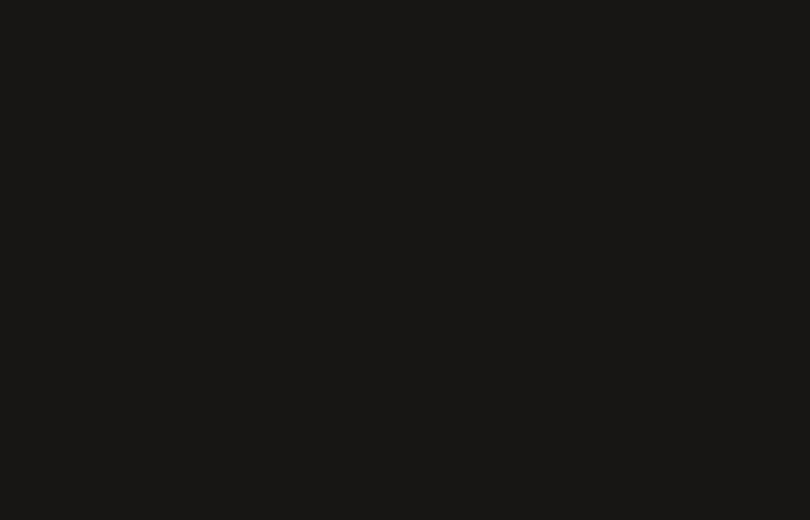

# FestiveIQ: Festive-Sale Demand, Pricing & Assortment Copilot with AI Layer

[](tests/test_core.py)
[](app.py)
[](src/analyst.py)

Category managers and demand planners must decide before a major festive sale:
1. **How much inventory to hold** per category?
2. **Which products deserve fast-delivery shelf space** (e.g., M-Now / 10-minute delivery)?
3. **How much discount to give** without destroying gross margin?

FestiveIQ answers these three critical commercial decisions from two years of retail transaction data (~1M rows) and provides an English-speaking AI analyst layer with deterministic numeric guardrails.

---

## Dashboard Preview



The application features a 6-tab Streamlit dashboard:
1. **Executive Overview**: High-level sales KPIs, monthly trends, MoM growth, and category share.
2. **Festive Demand Planner**: 1-week and 4-week ahead demand forecasts (ML vs 3 baselines and ensemble).
3. **M-Now Fast-Delivery Picker**: Stock selection for quick-commerce pods with historical backtesting.
4. **Pricing Simulator**: Interactive discount sensitivity and margin profit-maximization scenarios.
5. **Ask the Analyst (AI)**: Natural language to read-only SQLite execution with safety guardrails.
6. **Weekly Brief (AI)**: Automated executive briefing verified against Python-computed ground truth.

---

## Architecture & Workflow

| Stage | Module | What It Does | Guardrail / Evaluation |
|---|---|---|---|
| **1** | `clean_load.py` | Cleans duplicates, non-product fees, negative adjustments, and mistaken mega-orders. Loads SQLite `retail.db`. | Audited in `outputs/cleaning_log.csv` (1,003,212 clean sales kept). |
| **2** | `queries.py` | Calculates core e-commerce metrics in SQL (AOV, repeat rate, return rate, MoM window growth). | Deterministic SQLite aggregation. |
| **3** | `categorize.py` | Maps products into 12 categories via keyword rules or Gemini LLM batch classification. | **70% accuracy** evaluated on 50 hand-labeled products (`label_me.csv`). |
| **4** | `forecast.py` | Predicts category demand across 1-week and 4-week horizons on the festive peak test window. | Evaluated against 3 simple baselines + blend using WAPE. |
| **5** | `mnow.py` | Selects fast-delivery assortment using velocity, consistency, and low-return filters. | Backtested: Top units captured **23.9%** of festive units. |
| **6** | `pricing.py` | Estimates fixed-effects price elasticity ($\approx -1.67$) and simulates profit vs discount curves. | Mathematical break-even rule: $|e| > 1/\text{margin}$. |
| **7a** | `analyst.py` | Natural English to SQL with schema injection and safety validator. | **13/15 (86.7%)** accuracy on golden hand-written test suite. |
| **7b** | `brief.py` | Generates a 4-sentence managerial brief using Gemini. | Regex number verifier (`check_numbers`) rejects any fabricated figures. |
| **8** | `app.py` | Streamlit interactive dashboard with Plotly charts. | Auto-decompresses database zip for cloud hosting. |

---

## Real Benchmark Results

### 1. Forecast WAPE (Weighted Absolute Percentage Error — Lower is Better)
*Tested on the festive ramp-up: Oct 3 to Dec 4, 2011*

| Horizon | ML Model (Ridge) | Same Week Last Year | Last-Year $\times$ Growth | 4-Week Moving Avg | 50/50 Model + LY Blend |
|---|---|---|---|---|---|
| **1-Week Ahead** | 23.7% | 20.4% | 17.8% | **17.8%** | 19.4% |
| **4-Weeks Ahead** | 21.4% | 20.4% | 22.2% | 23.9% | **18.9%** |

*Key Takeaway*: At short horizons (1 week), simple moving averages beat ML. At longer horizons (4 weeks), seasonal patterns dominate, and a model + last-year blend provides the lowest error.

### 2. M-Now Assortment Selection Backtest
*Selected using data before Oct 3, 2011; evaluated on the festive period.*

| Assortment Strategy | Products Picked | Festive Units Captured | Festive Return Rate | Still Selling % |
|---|---|---|---|---|
| **Top Products by Past Units (Default)** | **120** | **23.9%** | **1.97%** | **96.7%** |
| Composite Score (Velocity + Consistency) | 120 | 19.1% | 2.42% | 97.5% |
| Top Products by Past Revenue | 120 | 19.4% | 2.30% | 96.7% |

*Key Takeaway*: The simpler rule (top products by historical units) captured more volume with lower return rates than the complex composite score.

### 3. Price Sensitivity & Margins
- **Estimated Elasticity ($e$)**: $\approx -1.67$ (Pooled fixed effects across 69,923 single-list-price observations).
- **Economic Break-Even**: At an assumed 30% gross margin, discounts increase profit **only if** $|e| > \frac{1}{0.30} \approx 3.33$.
- *Commercial Conclusion*: Because price elasticity is $-1.67$ (well above $-3.33$), flat discounts erode net profit. Price cuts should only be used strategically to clear stale inventory.

### 4. AI Guardrails & Benchmarks
- **Rule Categorizer**: **70% accuracy** on 50 hand-labeled products. Edge cases documented: keyword collisions (e.g. `COLOURING` matching toys before stationery).
- **AI Analyst**: **13/15 (86.7%)** accuracy on golden SQL benchmarks. Guardrails: read-only connection, strict single-SELECT check, and 200-row result cap.
- **AI Brief**: 100% of generated numbers verified against Python facts. Zero hallucinations permitted.

---

## Unit Testing

Run the test suite:
```bash
pytest -q
```
**Result**: 18 passed in test suite covering cleaning rules, SQL syntax validation, elasticity break-even math, forecasting leak prevention, and fact-checking validators.

---

## Quickstart

### 1. Clone & Install
```bash
git clone https://github.com/varshinisharma05/FestiveIQ.git
cd FestiveIQ
python -m venv .venv
source .venv/bin/activate  # On Windows: .venv\Scripts\activate
pip install -r requirements.txt
```

### 2. Configure Environment (Optional for AI Features)
Copy `.env.example` to `.env` and add your Gemini API key:
```env
GEMINI_API_KEY=your_key_here
GEMINI_MODEL=gemini-3.5-flash-lite
```
*(Without an API key, the dashboard runs seamlessly using golden SQL questions and verified template briefs).*

### 3. Launch Dashboard
```bash
streamlit run app.py
```
*(On first run, the app automatically extracts `data/retail_db.zip` into SQLite `retail.db`).*

---

## Deployment (Streamlit Community Cloud)

This repository is optimized for **Streamlit Community Cloud**:
1. Fork or push this repository to GitHub.
2. Go to [share.streamlit.io](https://share.streamlit.io/) and select the repo.
3. Set entry point to `app.py`.
4. In Advanced Settings, add `GEMINI_API_KEY` to Secrets if using live AI generation.
5. Click **Deploy**! (The database auto-decompresses on first boot without exceeding GitHub's file limits).
