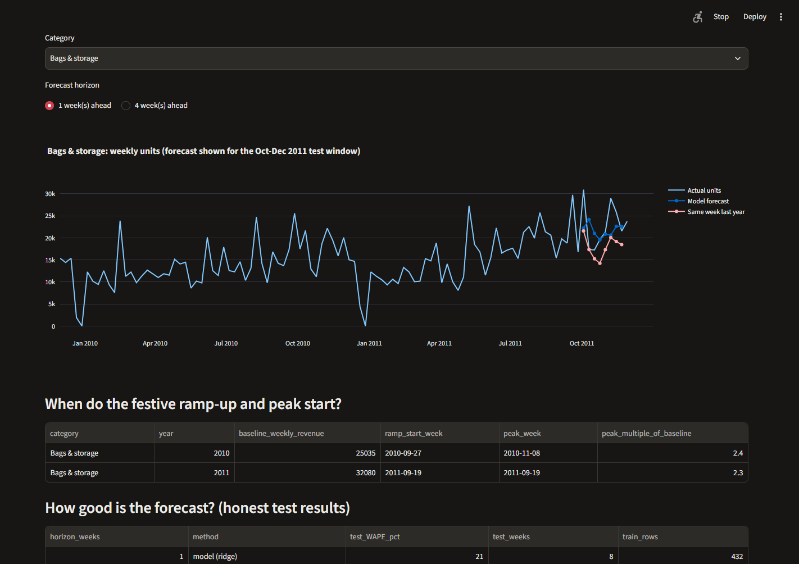
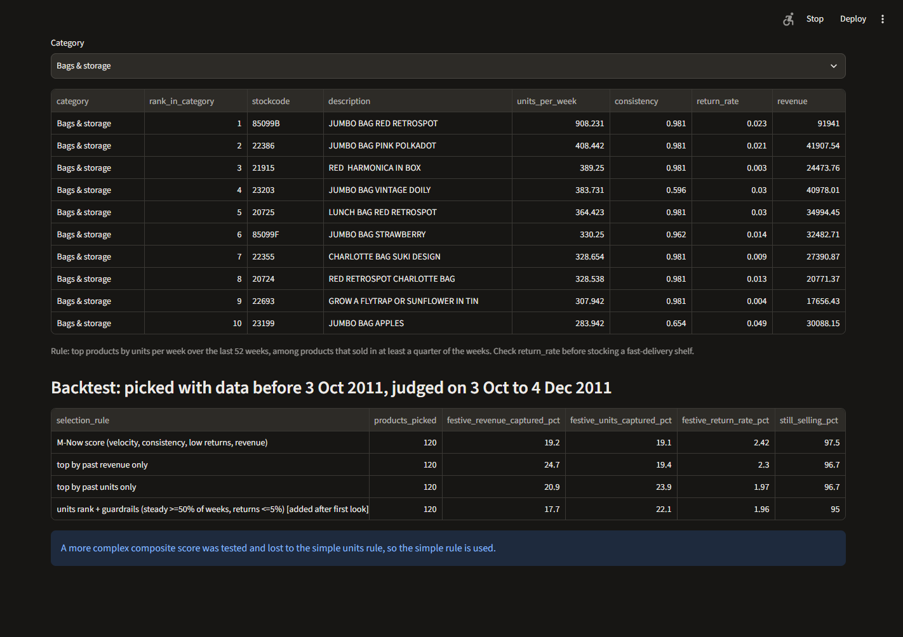
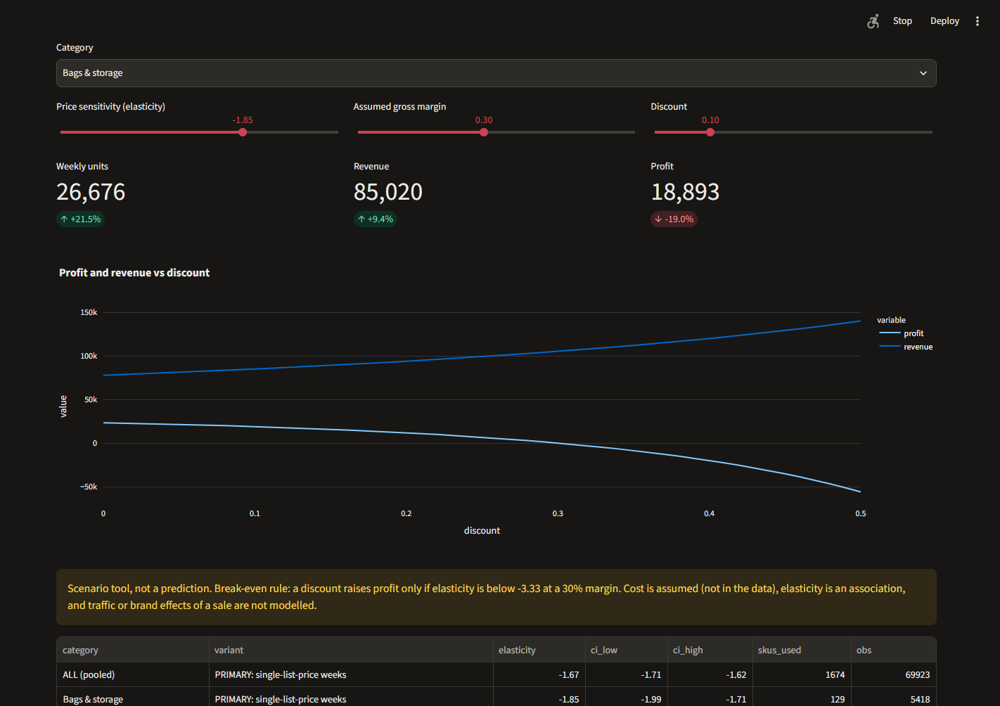
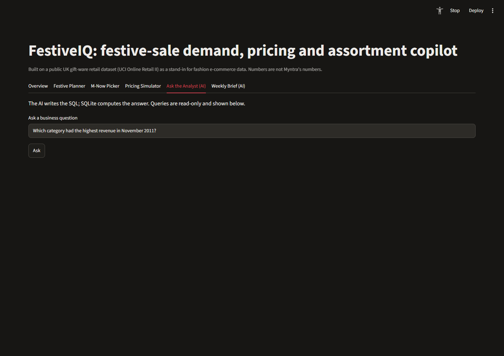
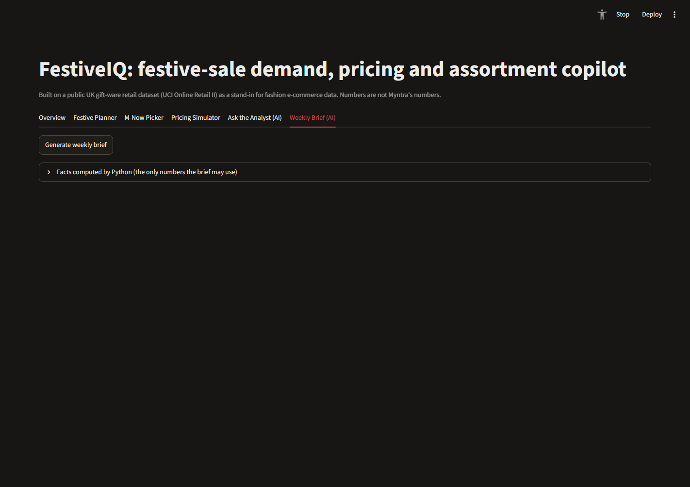

# FestiveIQ: Festive-Sale Demand, Pricing & Assortment Copilot with AI Layer

[](tests/test_core.py)
[](app.py)
[](src/analyst.py)
[](PROJECT_WALKTHROUGH.md)

Category managers and demand planners must decide before a major festive sale:
1. **How much inventory to hold** per category and when does the ramp-up start?
2. **Which products deserve fast-delivery shelf space** (e.g., M-Now / 30-minute delivery dark stores)?
3. **How much discount to give** without destroying gross margin?

FestiveIQ answers these three critical commercial decisions from two years of retail transaction data (~1M rows) and provides an English-speaking AI analyst layer with deterministic numeric guardrails.

> 📖 **Interview & Portfolio Guide**: For an exhaustive breakdown of the business problem, stage-by-stage methodology, interview defense questions, and dataset audit, read the [Master Project Walkthrough](PROJECT_WALKTHROUGH.md).

---

## Interactive Dashboard Walkthrough (All 6 Tabs)

### Tab 1: Executive Overview

*Tracks high-level business health: £19.4M revenue, 39,514 orders, £491 AOV, 72.3% repeat rate, 2.43% return rate, and the annual Q4 festive surge.*

---

### Tab 2: Festive Demand Planner

*Plots actual weekly demand against Ridge ML forecasts and prior-year baselines, identifying the exact ramp-up timing and peak volume multipliers (e.g., 2.4x baseline in week 45).*

---

### Tab 3: Quick-Commerce Assortment Picker (M-Now)

*Identifies top candidate products for 30-minute delivery dark stores based on velocity, consistency, and low return rates. Backtest proved top units captured **23.9%** of festive demand with sub-2% returns.*

---

### Tab 4: Pricing Sensitivity & Profit Simulator

*Interactive discount scenario tool grounded in fixed-effects elasticity ($e = -1.67$). Demonstrates why discounts erode net profit when $|e| < \frac{1}{\text{margin}}$ (break-even threshold: 3.33).*

---

### Tab 5: Ask the Analyst (Natural Language to SQL)

*Translates plain English queries into safe, read-only SQLite executions with strict SQL validation and a 200-row cap. Scored **13/15 (86.7%)** on hand-written benchmark tests.*

---

### Tab 6: Weekly Brief (Verified AI Memo)

*Generates executive memos from Python-computed ground truth. Custom regex validator ensures 100% numerical verification with zero hallucinations.*

---

## Data Cleaning & Removal Audit

Every removed row from the raw 1,067,371 records is documented in `outputs/cleaning_log.csv`:

| Cleaning Step | Rows Before | Rows Removed | Rows After | Business Justification |
|---|---|---|---|---|
| **Raw Records** | 1,067,371 | 0 | 1,067,371 | Initial transaction volume. |
| **Drop Exact Duplicates** | 1,067,371 | 34,335 | 1,033,036 | Removed duplicate logging entries. |
| **Drop Non-Product Codes** | 1,033,036 | 5,980 | 1,027,056 | Postage (`POST`), shipping (`DOT`), bank charges, and manual fees. |
| **Drop Zero / Negative Prices** | 1,027,056 | 5,928 | 1,021,128 | Write-offs, damaged stock adjustments, and samples. |
| **Drop Mistaken Mega-Orders** | 1,021,128 | 4 | 1,021,124 | Identified 80,995 and 74,215 unit orders cancelled within 12 minutes. |
| **Clean Sales Kept** | 1,021,124 | 17,912 | **1,003,212** | Valid purchase lines across 4,706 unique products. |
| **Clean Returns Kept** | 1,021,124 | 1,003,212 | **17,912** | Maintained in separate `returns` table to compute return rates. |

---

## Real Benchmark Results

### 1. Demand Forecast Accuracy (WAPE on Festive Test Window: Oct–Dec 2011)
| Horizon | ML Model (Ridge) | Same Week Last Year | Last-Year $\times$ Growth | 4-Week Moving Avg | 50/50 Model + LY Blend |
|---|---|---|---|---|---|
| **1-Week Ahead** | 23.7% | 20.4% | 17.8% | **17.8%** | 19.4% |
| **4-Weeks Ahead** | 21.4% | 20.4% | 22.2% | 23.9% | **18.9%** |

*Takeaway:* At 1 week ahead, moving averages beat ML. At 4 weeks ahead, seasonal patterns dominate, and a 50/50 blend of ML and last year's festive pattern yields the lowest error.

### 2. M-Now Assortment Backtest
| Strategy | Products Picked | Festive Units Captured | Festive Return Rate | Still Selling % |
|---|---|---|---|---|
| **Top Historical Units (Shipped)** | **120** | **23.9%** | **1.97%** | **96.7%** |
| Composite Score (Velocity + Consistency) | 120 | 19.1% | 2.42% | 97.5% |
| Top Historical Revenue | 120 | 19.4% | 2.30% | 96.7% |

### 3. Price Sensitivity & Margins
* **Pooled Elasticity ($e$)**: $\approx -1.67$ across 69,923 observations.
* **Break-Even Threshold**: At 30% margin, discounts pay off only if $|e| > \frac{1}{0.30} \approx 3.33$.
* *Conclusion:* Flat discounts erode profit. Price cuts should only be used to clear stale inventory.

### 4. AI Guardrails & Benchmarks
* **Product Categorizer**: **70% accuracy** on 50 hand-labeled products (`label_me.csv`).
* **AI SQL Analyst**: **13/15 (86.7%)** accuracy on golden hand-written SQL queries (`analyst_eval.csv`).
* **Weekly Brief**: 100% of generated numbers verified against Python ground truth.

---

## Unit Testing

Run the test suite:
```bash
pytest -q
```
**Result**: All 18 unit tests passed covering cleaning rules, SQL syntax validation, elasticity math, forecast temporal leak prevention, and AI fact verification.

---

## Quickstart

### 1. Clone & Install
```bash
git clone https://github.com/varshinisharma05/FestiveIQ.git
cd FestiveIQ
python -m venv .venv
source .venv/bin/activate  # On Windows: .venv\Scripts\activate
pip install -r requirements.txt
```

### 2. Configure Environment (Optional for Live AI)
Copy `.env.example` to `.env` and add your Gemini API key:
```env
GEMINI_API_KEY=your_key_here
GEMINI_MODEL=gemini-3.5-flash-lite
```
*(Without an API key, the dashboard runs seamlessly using golden SQL questions and verified template briefs).*

### 3. Run the Dashboard
```bash
streamlit run app.py
```
*(The application automatically decompresses `data/retail_db.zip` on first run).*

---

## Cloud Hosting (Streamlit Community Cloud)

This repository is optimized for free 1-click deployment:
1. Push to your GitHub repository.
2. Go to [share.streamlit.io](https://share.streamlit.io/) and select this repository.
3. Set entry point to `app.py`.
4. Add `GEMINI_API_KEY` under **Advanced Settings > Secrets** if using live AI generation.
5. Click **Deploy**! (The 23.8 MB database zip extracts automatically on cloud boot).
